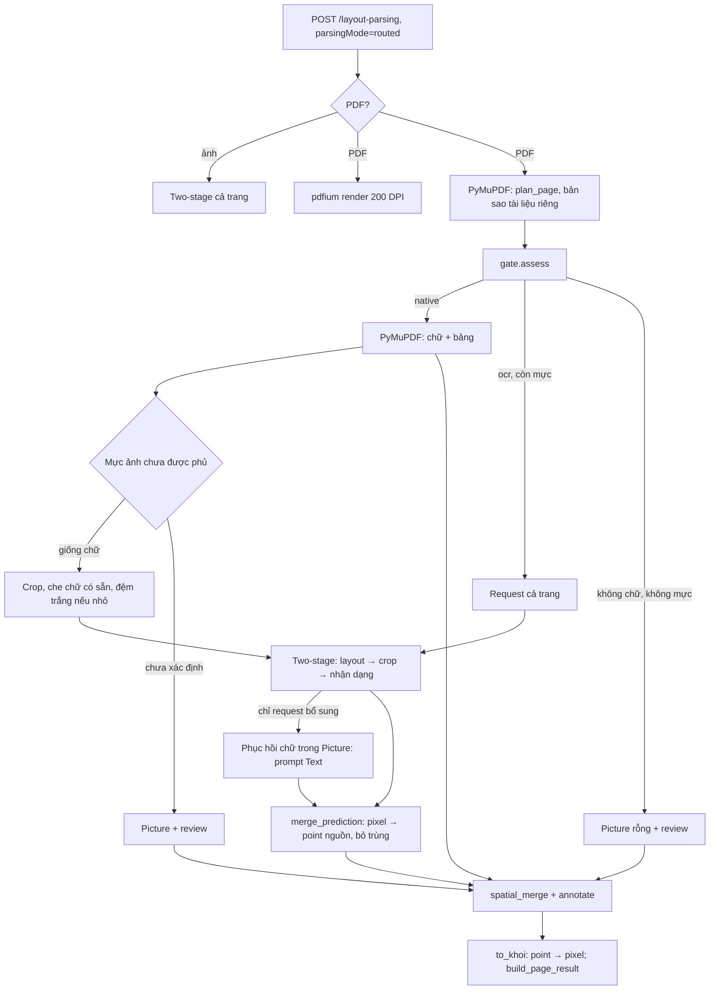

# Chế độ định tuyến theo trang (`parsingMode: "routed"`)

Tài liệu này mô tả cách gateway cài đặt router theo trang. Nguồn là `/home/jovyan/workspace/ocr/legal-vi-ocr/docs/page-router-architecture.md` của legal-vi-ocr tại `6e7ad59`. Lý do chọn thiết kế nằm trong [ADR-0007](adr/0007-native-first-page-routing.md).

## Luồng

`routing.decision` chỉ có hai giá trị, `native` và `ocr`. Trang `native` vẫn có thể có OCR bổ sung. `routing.page_type` (`native` | `scan`) cho biết trang có trích được ký tự hay không. Đây không phải quyết định định tuyến.

## Bản đồ code

| File | Nguồn legal-vi-ocr `6e7ad59` | Vai trò |
|---|---|---|
| `routed.py` | `routed_run.py` (viết lại) | `NativeDocument`, `plan_page`, `prepare_request`, `recover_pictures`, `merge_prediction`, `to_khoi`, `parse_routed_page`. |
| `router/gate.py` | `router.py` (nguyên văn) | `GateConfig`, `assess`, `has_text_lines`, `merged_regions`, `pixel_box`. |
| `router/profiler.py`, `router/geometry.py` | `profiler.py`, `page_geometry.py` (trích) | Tín hiệu Lớp chữ; `gray`, `background`, `text_mask`. |
| `router/native.py`, `router/insertions.py` | nguyên văn / bỏ CLI survey | Trích `rawdict`, đưa span chèn sau về đúng dòng. |
| `router/native_tables.py` | bỏ survey/check CLI | `find_tables()`, làm sạch lưới, kiểm giữ token, fallback cục bộ. |
| `router/picture_recovery.py` | bỏ `pending_for_prediction` | `candidates` với policy `textual-picture-v3`. |
| `router/review.py` | `routing_review.py` (đổi dạng Khối) | `spatial_merge`, `annotate`, `flag`, `picture`. |
| `router/canonical.py`, `router/views.py` | nguyên văn / trích `_table` | Contract nội bộ của adapter native; HTML bảng. |

Bên trong, Khối định tuyến dùng tọa độ point PDF chưa xoay, tương đối CropBox. Đây là hệ tọa độ của trích xuất PyMuPDF. Mỗi Khối có `label` (Nhãn Monkey), `content`, `raw_text`, `source`, `review` và `config`. `to_khoi` đổi bbox sang pixel của trang đã render, kể cả `/Rotate`. Đây là cùng hệ pixel mà các chế độ khác trả về.

## Request OCR

| Loại | Ảnh gửi đi | Phục hồi chữ trong Picture |
|---|---|---|
| Cả trang (`region: null`) | Trang render 200 DPI, giữ nguyên | Không |
| Bổ sung (`region`: point) | Crop từ trang render. Chữ có sẵn bị tô trắng, có lề 1 pt. Vùng nhỏ hơn 4% trang được đệm trắng 12 pt (33 px). | Có: Picture có cả hai cạnh ≥ 144 pt và có nét giống chữ |

`merge_prediction` đổi tọa độ theo các bước:

1. Pixel của request → point cục bộ.
2. Tịnh tiến theo `visual_bbox`, đã gồm phần đệm.
3. Nhân với `derotation_matrix`.
4. Cắt theo biên trang.

Khối có chữ mà bbox bị từ có sẵn phủ quá 50% bị bỏ như bản trùng theo không gian. Code không so chuỗi. `spatial_merge` chèn Khối bổ sung trước Khối có sẵn đầu tiên nằm dưới nó và giao với nó theo trục x. Thứ tự giữa các Khối có sẵn không đổi. Trang OCR cả trang giữ thứ tự đọc của Monkey.

## Response

Contract PaddleOCR-VL không đổi. Routed mode chỉ thêm các trường sau:

| Trường | Ý nghĩa |
|---|---|
| `prunedResult.routing.decision`, `reasons`, `signals`, `thresholds` | Bằng chứng của gate, không phải điểm accuracy. |
| `routing.effective_mode` | `native-only`, `native+ocr`, `full-ocr` hoặc `near-blank-review`. |
| `routing.requests[]` | `id`, `region`, `masked_native_words`, `padding_pixels`, `image_size`, `visual_bbox`, `blocks`, `picture_text_blocks`, `dropped_spatial_duplicates`, `issues`. |
| `routing.review_reasons[]` | Danh sách `{code, ...bằng chứng}`, ví dụ `supplemental_ocr`, `unrecognized_small_image`, `table_requires_review`, `unexpected_script`, `low_contrast_ocr_required`. |
| `routing.native_fallback`, `table_fallbacks`, `native_tables_skipped` | Adapter bảng lỗi, bảng bị loại về text, hoặc trang xoay không dò bảng. |
| `routing.review`, `page_type`, `coordinate_unit` (`pt`) | Trang cần người kiểm; trang có chữ hay scan; đơn vị tọa độ trong `routing`. |
| `parsing_res_list[].block_source`, `block_review` | `native`, `ocr` hoặc `routing` (Picture do router giữ lại); cờ review của Khối. |
| `model_settings.page_router` | Nguồn port, engine native, chế độ OCR, policy. |

Bảng có sẵn có `block_label: "table"` và HTML trong `block_content`. Picture do router giữ lại là Khối `image`. Crop của nó nằm trong `markdown.images`, như mọi Picture.

## Khác với batch runner của legal-vi-ocr

- Không có manifest, kiểm hash ảnh chẩn đoán, `--prepare-only`, `--ocr-run` (replay) hay artifact trên đĩa. Gateway tự render trang. Test dùng fake server (seam 1) và parity test (seam 2).
- Một lần gọi suy luận lỗi làm cả request lỗi (503/504/500), như hai chế độ kia. Không có trang `pending` hay `error`, nên cũng không có cờ `ocr_pending`, `ocr_failed`, `ocr_truncated`.
- Trang OCR cả trang giữ thứ tự Monkey. Batch runner sắp lại theo trên→dưới, trái→phải.
- Mỗi trang được lập kế hoạch trên một bản sao PyMuPDF riêng. Trang có `/Rotate` không dò bảng (xem ADR-0007).
- Ảnh đầu vào đi thẳng nhánh OCR cả trang, với `reasons: ["image_input_without_text_layer"]`.

## Giới hạn

Các giới hạn sau giống bản gốc. Ngưỡng là heuristic chưa hiệu chỉnh. Chữ màu, chữ rất nhỏ, chữ rất mờ hoặc chữ chỉ có dạng vector có thể bị bỏ sót. Router không phát hiện dấu hay chữ ký. Bbox của chữ phục hồi phủ cả Picture. Không nối bảng qua trang. Một trang có `routing.review: false` vẫn có thể thiếu chữ hoặc nhận dạng sai.
